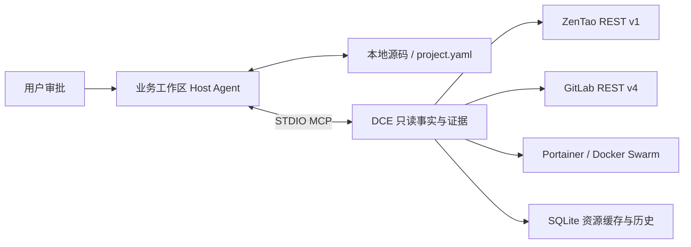

# DevOps Context Engine（DCE）

DCE 把 ZenTao 缺陷、GitLab 代码/CI 和 Portainer/Swarm 部署事实连接到 Cursor 等 Agent，减少每次排查时重复查平台、猜项目关系的工作。当前本地体验版：**1.1.1**；后续开发分支：`feature/upgrade-chatgpt`。

DCE 提供安全只读能力，Host Agent 使用当前业务源码和自己的模型提出关系，经用户审核后维护 `.dce/project.yaml`。关系可跨仓库、模块、镜像和服务；来源实例和各平台 ID 分开，不因同名或同数字自动确认。未知关系保持 proposed/unresolved，环境和部署版本要有证据。



核心能力：

- 九个只读 MCP 工具：bug_context、project_context、discovery_status、deployment_inspect、pipeline_diagnose、service_trace、zentao_query、gitlab_query、portainer_query。
- 项目/模块发现、证据、候选与人工审核、跨会话恢复及变化标记；Project Schema v1/v2 校验和迁移预览。
- Bug、原生图片、固定 ref 的代码、CI Job/Trace、Stack 保存配置与 Swarm 运行事实；分页、输出预算、结构化错误和脱敏。
- ZenTao 进程内 Token 缓存与有限恢复；Service Logs 默认关闭，可另行限定精确服务、短窗口、单次额度并撤销。

## 快速开始

Python >=3.12、uv、Git。本轮代码只在本机，尚未推送；在当前交付仓库运行：

```sh
git switch feature/upgrade-chatgpt
uv sync --locked --dev --python 3.12
uv run --offline dce --help
uv run --offline dce doctor --mock
uv run --offline python scripts/run_acceptance.py
```

首次依赖准备需要包源；完整验收仅用本机合成 HTTP/STDIO，不读取公司凭证、不访问真实公司服务。每次生成 [自动化报告](docs/acceptance/AUTOMATED_ACCEPTANCE.md) 和 [机器摘要](docs/acceptance/acceptance-summary.json)。

## 连接 Cursor 与开始使用

按 [macOS 本地部署手册](docs/guides/LOCAL_DEPLOYMENT.md) 创建私有配置，使用 `.venv/bin/python scripts/serve_dce_local.py` 的真实启动参数接入 `~/.cursor/mcp.json`。凭证留在 0600 本机文件或受保护进程环境；默认不读 dotenv。为各平台提供独立 instance 与显式资源 allowlist，重载后验证九工具及版本 1.1.1。不要把 Token 写进聊天或 MCP 参数。

然后在**业务工作区**让 Agent 按 [初始化 Prompt](prompts/agent-led/initialize.md) 发现结构、收集事实、展示关系与 diff，经审核再保存项目文件。完整十五个教程及“Bug→代码→CI→部署服务”示例见 [用户手册](docs/guides/USER_GUIDE.md)。

## 当前边界与证据

DCE 不提供自动修复、触发 CI、MR、redeploy 或禅道回写。日志需独立授权，输出有界事件摘要；Stack Status/副本数不等于业务健康，latest 不证明部署版本。旧六工具中的 Catalog 关系是历史线索，当前项目文件由 Host 管理。

本轮离线验收结果以最新报告为准。历史 Cursor Gate A、限定日志 Gate B 见 [原日期摘要](harness/v1.1-final-acceptance.md)；本轮未重跑桌面 Host 或真实平台。**真实 ZenTao Token 过期恢复仍 not_verified**，Mock 成功不代表生产验收。新环境模块权限、日志保留期和完整 Python 版本矩阵也需另验。

更多说明：[基线升级差异](docs/UPGRADE_FROM_BASELINE.md) · [执行报告](docs/UPGRADE_EXECUTION_REPORT.md) · [清理记录](docs/acceptance/REPOSITORY_CLEANUP.md) · [工具契约](docs/MCP_FACT_TOOLS.md) · [安全边界](docs/SECURITY.md) · [计划](PLANS.md)。
