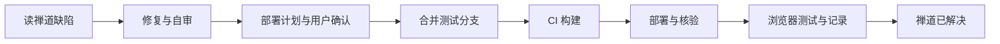

# DCE 2.0.0

给 Cursor / Codex 的 MCP 工具集，连接禅道、GitLab 和 Portainer，支撑测试环境的缺陷修复闭环。



## 版本与分支

| 分支或标签 | 用途 |
|---|---|
| `main` | 默认分支，当前稳定版本为 DCE 2.0.0 |
| `feature/v2.0.0` | DCE 2.0.0 分支 |
| `feature/v1.0.0` | DCE 1.x 历史分支，保留 1.2.0 的实现和文档 |
| `v2.0.0` | DCE 2.0.0 的固定发布快照 |

## 安装

需要 Python 3.12 和 uv。以下命令在本仓库目录运行。

### 使用

从 `main` 构建并安装固定版本的 wheel。

```sh
uv build --wheel
uv tool install --python 3.12 --force dist/devops_context_engine-2.0.0-py3-none-any.whl
dce --version
```

### 开发

在 `main` 或 `feature/v2.0.0` 上同步锁定的开发依赖并检查版本。

```sh
uv sync --locked --dev
uv run dce --version
```

配置合成样例在 `examples/`；凭证放在进程私有的凭证文件中，权限为 0600。

从 [使用指南](docs/v2/08-使用指南.md) 开始配置 Cursor 或 Codex。
设计、工具契约和验收入口见 [DCE 2.0 文档](docs/v2/README.md)，当前进度见 [progress.md](docs/v2/progress.md)。
