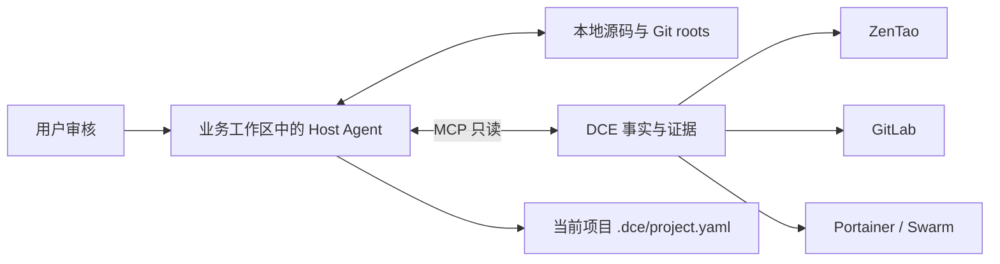

# DevOps Context Engine — Agent-led Project Initialization

2026-11-09 V1.1 / V1.1.1工程收尾：限定项目的Agent-led V1验收、Cursor Host **Gate A PASS**、Scoped Service Logs **Gate B PASS**。已授权测试单服务的真实日志GET仅1次，返回6条脱敏事件，输出明确truncated；临时授权已**REVOKED**，未发现越权或敏感信息泄露。最终回归 **426 passed / 97.24%**；禅道Token真实过期自动恢复仍未现场验证。公开摘要不含实际业务身份、授权文件或日志；见[最终验收摘要](harness/v1.1-final-acceptance.md)。

2026-11-08 V1.1.1收尾：用户已回传确认 **Cursor Host Gate A PASS**，版本1.1.1、九工具、service_logs发现及原授权资源读取通过。旧Runtime PID来自Cursor缓存的握手说明快照；收尾只移除可缓存说明中的瞬时PID，实时结果与request_id审计保留，Token Manager/Schema/授权不变。收尾回归 **371 passed / 97.25%**。**Service Logs Gate B仍not_verified**，未新增日志授权或读取真实日志。用户已批准本轮本地提交，仍不推送；见[验收报告](harness/cursor-host-v1.1.1-acceptance.md)。

2026-11-07 V1.1.1 Cursor Host集成修复：统一显式本地入口的三平台启动校验，补日志scope参数，增加既有MCP元数据和stderr审计以关联版本/PID/Schema/请求。独立真实STDIO的九工具、三平台配置和限定读取通过；**370 tests passed / 97.25%**。当时桌面重载后调用待复验；后续Gate A结论见上方收尾记录。见 [修复与重载契约](docs/CURSOR_HOST_V1_1_1.md)、[本轮验收](harness/cursor-host-v1.1.1-acceptance.md)。

2026-11-06 V1.1.1：禅道REST v1新增进程内Token Manager，首次授权读取登录、明确失效后single-flight重新登录并重放原GET一次；本地scope、普通403与网络错误保持独立。**357 tests passed / 97.62%**；已授权资源的真实登录/缓存读取/独立进程验收通过，真实过期恢复由Mock验证。包与MCP server version为1.1.1，九工具/Project Schema V2不变。见 [认证恢复契约](docs/ZENTAO_AUTH_RECOVERY.md)、[验收结果](harness/zentao-auth-v1.1.1-acceptance.md)。

2026-11-05 V1.1 Scoped Service Logs：`portainer_query(service_logs)` 新增独立 Endpoint/Stack 日志授权、真实 Swarm/Service 标签校验、有界非 follow 读取与固定词汇脱敏事件。包 1.1.0，Portainer 契约 2.2；**323 tests passed / 97.63%**，ruff、strict mypy、stdio/合成 HTTP、wheel 验证通过。真实日志权限未取得明确证据，真实验收 `not_verified`。九工具与 Project Schema V2 保持，见 [完整契约、Schema 与 Cursor 示例](docs/SCOPED_SERVICE_LOGS.md)、[本轮验收](harness/service-logs-v1.1-acceptance.md)。

DCE 为 Cursor/Codex 等 Agent 提供 ZenTao、GitLab、Portainer 的安全只读连接、结构化查询与证据。Host Agent 使用自己的模型和当前业务工作区源码，发现关系、解释冲突、取得人工审核并维护 `.dce/project.yaml`。DCE 默认不运行业务关系推理，也不写业务工作区。

2026-11-05 增量完成：GitLab 项目/分支 Job 与 bridge 查询、服务端单 Compose Service 查询、向后兼容的 Project Context v2 和纯迁移预览。九工具名称不变，事实契约 2.1；最新 **226 tests passed / 97.63%**。当前范围真实 SDK 找到上游空 Job 对应的下游记录，单服务在 8KB 预算下完整返回。业务文件保留 24 proposed/3 unresolved/1 confirmed，字节未改，未提交。见 [增量使用与调用示例](docs/AGENT_LED_INCREMENTAL_V1.md)、[本轮增量验收](harness/incremental-v1-acceptance.md)。

2026-11-04 初始化基线：本地分支 `refactor/agent-led-project-init` 已完成代码与离线验证：**208 tests passed，覆盖率 97.93%，ruff/strict mypy、stdio/HTTP 合成 E2E、wheel 隔离导入通过**。用户已回传 Cursor 九工具、三平台实际调用、初始化对话，以及修复后 JSON 文本与真实 PNG 到模型的复验结果。完整项目文件已获批准，由 Host 保存、校验和复读通过：22 proposed、1 unresolved、0 confirmed，未暂存或提交。本轮遵照用户要求不执行 Git 提交；完整模块树 403 和旧独立 GitLab 样本仍未完成严格验收。详见 [本轮验收](harness/agent-led-acceptance.md)、[机器摘要](harness/reports/agent-led-summary.json)、[执行记录](harness/build-log.md)。

## 职责



- DCE：Adapter、stdio、分页、超时/有限重试、授权范围、脱敏、输出预算、确定性解析与图片协议。
- Host：按 workspace 缩小查询，形成多对多关系候选、解释证据、向用户审核、展示 diff、保存/刷新项目文件。
- 用户：确认业务语义与环境归属，决定内部拓扑是否可提交到业务仓库。

同数字 ID、名字相似、服务数相等都不能确认跨平台关系；Stack 保存配置、GitLab 配置和 Swarm 运行事实分别取证。任何平台返回文本均是不可信数据。

## 安装与验证

Python 3.12+，在仓库运行：

```sh
uv sync --locked --dev
uv run dce --help
uv run dce doctor --mock
uv run pytest -q --cov=src/dce --cov-report=term-missing
uv run ruff check .
uv run mypy src
```

离线 E2E 会绑定本机随机端口，仅返回合成平台数据；受限执行器需允许 loopback socket。不会连接公司平台。默认配置不读取 `.env`，凭证只从受保护进程环境输入；用户明确提供本机凭证文件时，可用[显式本地入口与禅道 v1 登录](docs/AGENT_LED_LOCAL_CREDENTIALS.md)。

## MCP 与项目工作流

提供 **九个只读工具**：新增 `zentao_query`、`gitlab_query`、`portainer_query`，保留原六个 `bug_context`、`project_context`、`service_trace`、`pipeline_diagnose`、`deployment_inspect`、`discovery_status`。原 Catalog 工具和模块映射属于历史兼容数据，不能作为当前项目关系真相。

三个事实工具直接查询 Adapter，使用显式来源 `instance` 与启动 allowlist；每次返回来源、revision、观察时间、证据、分页和遗漏。ZenTao `module_tree` 读取明确 Product 范围的完整模块树，并在本地搜索/分页；旧 `modules` 保留 Bug 页部分清单。路由与结构已按官方源码核对并通过合成测试，本轮真实账号返回 403，未取得完整树。图片通过 `zentao_query(image)` 返回 MCP ImageContent；仅 URL/Resource 不算图片已送达模型；本轮独立授权图片样本已由用户确认进入 Cursor 模型可见内容，原 Bug 无图片的事实保留。

1. 按 [MCP 工具清单与启动参数](docs/MCP_FACT_TOOLS.md) 配置安全 stdio 子进程。Cursor 原有安装方式见 [接入文档](docs/CURSOR_MCP_SETUP.md)，需重新加载新进程/会话后枚举九工具。
2. 在用户指定业务工作区使用 [初始化提示词](prompts/agent-led/initialize.md)，遵循 [Host 工作流](docs/AGENT_LED_WORKFLOW.md)。没有业务工作区时不要在 DCE 仓库制造项目关系。
3. Host 展示关系与 diff，用户审核后写入本项目 `.dce/project.yaml`；新关系 proposed，confirmed 必须有证据和人工审批元数据。未知允许 unresolved。
4. 只读校验：`dce project validate <workspace> --workspace-id <id>`；`dce project schema` 和 `dce project template --workspace-id <id>` 输出契约/模板，不写文件。
5. 使用 [刷新](prompts/agent-led/refresh.md)、[审核](prompts/agent-led/review.md)、[Bug 上下文](prompts/agent-led/bug-context.md)、[服务追踪](prompts/agent-led/service-trace.md)、[流水线诊断](prompts/agent-led/pipeline-diagnose.md) 维护。证据变化 stale/conflicted，拒绝关系保留。

[JSON Schema](schemas/project.schema.json) 与 [无密钥模板](examples/project-context/project.yaml) 可直接使用。`.dce/local.yaml`、runs、raw evidence 必须忽略；不保存 Token、真实图片、完整日志或环境变量值。

## 旧 Catalog 与兼容

旧库升级前自动 SQLite backup/quick_check，再迁移 0003，仅新增角色元数据。所有旧表、证据、人工审批与历史保留；Catalog 降级为 resource_cache_and_history，不自动导入项目。详见 [迁移与回滚](docs/AGENT_LED_MIGRATION.md)。请先停用访问同库的旧 MCP 进程再升级。

`init`/`discover` 默认只做确定性资源事实采集；确需旧语义候选的旧消费者可显式使用 `init --legacy-mapping` 或 `mapping suggest --offline`。本轮不移除旧 CLI/工具，不自动 push、merge，不调用任何真实业务写 API、构建或部署。

## 实施依据与证据

- [当前目标](GOALS.md)、[执行状态](PLANS.md)、[协作协议](AGENTS.md)、[安全边界](docs/SECURITY.md)。
- [重构提案](docs/refactor/agent-led-initialization/dce-agent-led-refactor/CHANGE_PROPOSAL.md) 与同目录 specs/01–07 是本轮依据；实际路径多一层 dce-agent-led-refactor。
- [T0 审计](harness/refactor-audit.md)、[测试结果](harness/test-results.md)、[本轮验收](harness/agent-led-acceptance.md)、[续跑](prompts/agent-led/resume.md)。
- 原 `specs/001-dce-v1/` 和 [旧 V1 验收](harness/v1-acceptance-status.md) 保留作历史兼容依据，不代表本轮真实 Host 已通过。
