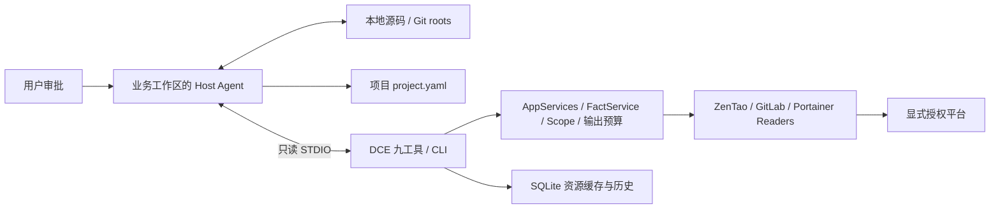

# DCE 本地体验版：基线差异与功能升级

核查日期：2026-11-11。本轮只使用本地 Git，没有 fetch、PR 操作或真实平台访问。

## 1. 基线与代码来源

基线选定 `main = 078962e5f65b3db5d9885d7d5f0f2c7bc9b7b9a1`（父提交 `afa0437`）。本地不存在 Tag，因此没有可替代 main 的稳定 Tag。main 是文档/实施骨架，没有可安装 Python 包；不能把相对 main 的新增描述为“原运行产品退化后恢复”。

有效功能来源为 `release/v1.1.1-public-clean = 2748c7b123462a1389f17f50ee1acf45e8342ab9`，唯一父提交就是 main。它与原验收 HEAD `5092d6a` 的 src、tests、scripts、fixtures、examples、schemas、pyproject.toml、uv.lock 完全一致；全部差异是 8 个历史文档，其中 5 份做脱敏泛化，另 3 份追加候选构建说明。当前原分支历史含敏感样本的风险已有 ADR-029 记录，本轮没有继承这些祖先。

在 `codex/upgrade-work` 从 main 导入干净快照并形成本地提交 `dba07db`；该提交树与 `2748c7b` 完全相同。后续本地产品整顿提交见 [执行报告](UPGRADE_EXECUTION_REPORT.md)；本次真实验收的 Git Commit 由 [机器摘要](acceptance/acceptance-summary.json) 精确记录。报告文件随后提交会形成不同 HEAD，不能把报告提交伪称执行时提交。

| 原本地分支 | HEAD | 实际作用/整合判断 |
|---|---|---|
| work/dce-v1-offline | 6fd0a90 | V1 Adapter、发现、Catalog、规则、CLI、六工具与工具自描述；是旧最终 HEAD 的祖先 |
| refactor/agent-led-project-init | f9eb80a | Host 主导关系、九工具、项目文件、迁移；是旧最终 HEAD 的祖先 |
| feat/scoped-service-logs-v1.1 | ff5c124 | 独立日志 Scope、有界读取/脱敏；是旧最终 HEAD 的祖先 |
| fix/zentao-token-refresh-v1.1.1 | 5092d6a | Token Manager、Cursor 运行身份、精确单次日志授权及收尾；干净候选的功能来源 |
| release/v1.1.1-public-clean | 2748c7b | 已脱敏独立快照；保留分支及其既有 worktree |

这些开发分支是顺序迭代，未发现需要再合入的旁支实验功能。旧历史与候选相对 main 分别有 38 和 1 个独有提交；没有直接 merge/cherry-pick 旧历史。删除分支前的代码等价和本机备份记录见执行报告。

## 2. 整体代码差异

`git diff --shortstat main 2748c7b`：**220 files changed, 25,768 insertions, 145 deletions**。快照共有 230 个跟踪文件，包含 55 个 Python 源文件、41 个测试文件。main→干净候选的主要增加是完整运行工程，不仅是文档。

本轮再增加统一离线验收、验收器失败路径测试、部署/使用指南、当前报告，删除旧原始 XML/coverage 明细，修正旧 MCP smoke 的过时 revision 断言及对合法截断的错误处理；产品包保持 1.1.1，未添加第十个工具。最终 main→交付提交的文件统计由执行报告记录。复核命令：

```sh
git log --oneline main..feature/upgrade-chatgpt
git diff --stat main feature/upgrade-chatgpt
git diff --name-status main feature/upgrade-chatgpt
git diff 2748c7b feature/upgrade-chatgpt -- src tests scripts schemas pyproject.toml uv.lock
```

## 3. 功能升级对照

“已实现”依据源码/Schema；“自动化”依据本轮新报告；“历史只读”仅引用原日期脱敏证据，不代表本次访问。下表不把合成数据当现场事实。

| 阶段 | 功能 | 原有问题 | 当前实现 | 用户价值 | 验收状态 |
|---|---|---|---|---|---|
| main 骨架→V1 | 可安装包/CLI | 仅规格与实施计划 | Python 3.12+、uv.lock、Typer、Wheel | 可本机运行/重装 | 已实现；本轮自动化 |
| V1 | 资源发现/静态模块解析 | 三平台各自查询 | 显式 Scope、分页/断点/增量、Maven/Gradle/Go/Node、Compose/CI 静态解析 | 复用资源事实，避免全库读取 | 已实现；合成自动化 |
| V1 | Catalog/证据/审核 | 关系容易混淆、无历史 | 实例复合 ID、规则边、版本证据、人工审核审计 | 可追溯，多对多、不靠相同数字 ID | 已实现；合成自动化 |
| Agent-led | Host 项目初始化 | 全局语义映射难以理解当前工作区 | Host 发现仓库/模块，查询九工具，形成候选并保存项目文件 | 利用 Agent 已有模型和当前源码 | 边界/保存/恢复已自动化；真实推理质量未验证 |
| Agent-led | proposed/confirmed/unresolved | AI 可能过早确认 | 新关系 proposed；confirmed 要证据和人工元数据；未知可 unresolved | 人掌握业务关系与环境判断 | 校验已自动化；真实人工身份不能由 YAML 认证 |
| Agent-led | 跨会话/变化检测 | 每次重复定位 | `.dce/project.yaml`；refresh 保留审核/拒绝/备注，变化 stale/conflicted | 下次会话有证据起点 | 已实现；合成保存/复读/隔离/增量自动化 |
| 增量 V1 | Job 定义与执行/分支 | Pipeline 空 Job 容易误判 | project_jobs/branch_jobs/pipeline_bridges；不递归扩 Scope | 看见手工 Job/下游线索与分页限制 | 已实现；合成自动化；历史限定读取有记录 |
| 增量 V1 | 项目 Schema V2 | 分支/镜像/环境/运行态混为一谈 | 分开表示定义/执行、tag/digest、部署/运行；v1 只读迁移预览 | 减少错误版本归属 | 已实现；Schema/纯迁移自动化 |
| V1.1 | Service Logs | 默认不能读日志 | 额外 Endpoint:Stack grant、服务身份复核、<=900 秒、行/字节/时间预算、follow=false、固定词汇投影 | 安全获得有限事件线索 | 已实现；合成自动化；历史 Gate B 有一次限定只读证据 |
| Gate B 收尾 | 精确服务/单次/撤销 | Stack pair 会覆盖多个服务 | 私有策略绑定实例/Stack/Swarm/Service，<=1 小时 TTL、300 秒窗口、原子一次额度、文件撤销 | 将一次授权限制到准确目标 | 已实现；跨进程/取消/撤销自动化；新环境权限未验证 |
| V1.1.1 | ZenTao Token Manager | 会话过期需重启/手动换 Token | 首读登录、内存缓存、明确失效 single-flight 刷新、原 GET 最多重放一次 | 减少重复登录与可恢复故障 | 已实现且 Mock/合成 STDIO；真实过期恢复 not_verified |
| V1.1.1 | Cursor STDIO 身份审计 | Host 可能缓存旧握手信息 | 稳定握手说明；实时版本/PID/request_id/Schema；审计 stderr | 可辨认实际运行进程 | 本轮 SDK 自动化；历史 Gate A 有记录；本轮桌面未验证 |
| 本轮 | 产品验收与手册 | 命令分散、README 混合旧结果 | 一键独立阶段/新 JUnit/覆盖率/Wheel 隔离运行，十五教程 | 能重复安装、体验和验证 | 以本轮自动化报告为准 |

## 4. 架构与模块



| 模块 | 代码 | 变化及价值 |
|---|---|---|
| 应用层 | `src/dce/app/{services,facts,mapping}.py` | CLI/MCP 复用服务；事实查询与旧语义 mapping 分开，默认不运行模型 |
| 平台读取 | `src/dce/connectors/` | 同源、只读、有限重试、错误分类；认证 POST 限登录；解压后大小校验 |
| 发现/解析 | `discovery/`、`parsers/metadata.py` | 有界静态提取，不执行 CI/README/Compose 中命令 |
| Catalog | `catalog/` | SQLite 迁移 0001–0003；迁移前私有 backup/quick_check；保留旧人工历史 |
| 项目 | `project/{model,context,details}.py` | 工作区隔离、Schema v1/v2、证据、审核/刷新/迁移纯函数 |
| MCP | `mcp/{server,contracts,facts_contract,startup}.py` | 九工具输入/输出 Schema；JSON text+structuredContent、原生图片、错误/遗漏/预算、运行身份 |
| 安全 | `security/`、`common/service_logs.py` | 显式凭证源、脱敏、精确日志 grant、时间与额度限制 |

早期 V1 把语义候选留在全局 Catalog。现在 Catalog 的角色是 `resource_cache_and_history`，当前项目关系由 Host 维护的 project.yaml 表达。旧 confirmed 不自动迁入新项目；旧 CLI/mapping/六工具保留兼容。

## 5. 数据模型与返回契约

资源 ID 由 source-instance、resource-type 和 external-id 组合，业务关系有独立 ID；不把 ZenTao Project、GitLab Project、Stack 的同数字 ID 视为同一实体。关系状态区分 proposed、confirmed、rejected、stale、conflicted、unresolved；规则直接证据与 AI 候选有区别。

Project V2 增加 source_branch、git_ref、ci_job_definition/execution、image_tag/digest、deployment_definition、runtime_observation 等独立概念。环境、不可变版本匹配都要明确证据；同名/latest 不能证明一致。迁移只输出候选，不写用户文件。

三个事实工具返回 envelope `status/data/error/truncated/omissions`，data 包括 source、observed_at、revision、records、evidence、pagination、warnings、verification 等（以发布 Schema 为准）。`verification=live_read_only` 描述 Adapter 路径，并不能证明请求目标是生产环境；本轮合成 HTTP 也走该路径。日志失败可附安全 FactData，其他普通错误通常 data=null。要检查分页/omitted/truncated，不能把空页当不存在。

## 6. 九个工具实际能力

| 工具 | 关键参数 | 实际行为/限制 |
|---|---|---|
| bug_context | bug_id, include_assets=false | Scope 内 Bug 摘要/安全附件引用与 Catalog 候选；不自动定位正确源码 |
| project_context | source, project_key, depth | 查询旧 Catalog 资源图；不读取当前业务 project.yaml |
| discovery_status | scan_id 可选 | 本地最近扫描状态，不主动扫描 |
| deployment_inspect | stack_key 或 service_key 恰好一个 | Catalog 快照/差异；health=unknown、environment=unresolved、version_match=not_verified |
| pipeline_diagnose | project_key, pipeline_id | 项目 allowlist 内 Pipeline/失败 Job/有界 Trace 摘要；不触发 Pipeline |
| service_trace | service_key, direction, max_depth | Catalog 正反向资源关系追踪；不能替代新项目关系审核 |
| gitlab_query | instance, operation, project_id/ref/path 等 | 项目、单层 tree、文件有界片段、commit、Pipeline/Jobs/bridges/Trace；无独立 branches 列表 operation，用已知 ref 查 commit/tree/branch_jobs |
| portainer_query | instance, operation, endpoint_id/stack_id 等 | Endpoint/Stack/Swarm/Service、解析后 StackFile/单服务、单独授权日志；不返回 Compose 原始秘密 |
| zentao_query | instance, operation, project_id/product_id/bug_id 等 | 项目/产品、Bug、模块树、附件、原生 ImageContent；module_tree 需 Product ID，权限独立 |

完整 operation 和互斥/必填约束见 [事实工具契约](MCP_FACT_TOOLS.md)、[CLI/MCP 契约](CLI_MCP_CONTRACT.md)、发布的 [Portainer Schema](../schemas/portainer-query.schema.json)。不是每个工具都会主动访问远端，六个兼容工具与三个事实工具的数据来源须区分。

## 7. 安全、测试与部署变化

默认不读 dotenv；显式本地入口仅字面解析 0600 常规文件、限制 64 KiB、拒绝 alias 冲突和 symlink。凭证不进入 MCP 参数/项目文件，ZenTao Token 仅进程内；403 方法权限与失效认证分开，不因普通拒绝重提密码。平台 URL 默认 HTTPS，HTTP 需独立显式放行。

日志默认关闭。Stack pair 是较宽的兼容授权；精确单次方案必须同时传 pair 和 `--portainer-log-policy`。服务身份远端复核，follow 永为 false，失败也消费单次额度，撤销文件立即使旧进程拒绝。输出是固定词汇事件/摘要及匿名关联 ID，不是原始日志搜索器；retention 未知时明确报告。

测试从 main 的无运行体系到 426 项既有回归；本轮增加验收器失败/超时/证据与网络隔离测试，并复用完整合成链路。本次计数/覆盖率只取 [最新报告](acceptance/AUTOMATED_ACCEPTANCE.md)。未降低 75% 的既有硬门槛，当前实测仍约 97%。

部署从规格变为单机 Python 包 + 私有 SQLite + Host 管理的 STDIO 子进程；不需要 Docker/后台 Web 服务。uv 锁定依赖，Wheel 在全新虚拟环境装入并从源码目录外运行 CLI/MCP。首次冷缓存下载不是离线验收，本轮只用本机缓存。

## 8. 未完成与实际改进

可感知的改进：一次部署后直接在 Agent 中查询事实，跨会话复用经过审核的项目关系，少读无关仓库/大 Stack，日志权限可单独限定与撤销，明确区分声明/运行/版本不确定性；出错可从结构化状态定位，并可在本机重复验收。

尚未完成/未验证：本轮 Cursor 桌面 Host 交互与图片进入模型；真实 ZenTao Token 过期自动恢复；新安装环境的真实平台兼容/模块树权限/日志权限及保留期；各支持 Python 版本完整矩阵；模型关系推理质量与真实审批身份认证。共享服务、Web UI、自动修复/CI 触发/MR/部署/禅道回写均属规划，不是已交付功能。
