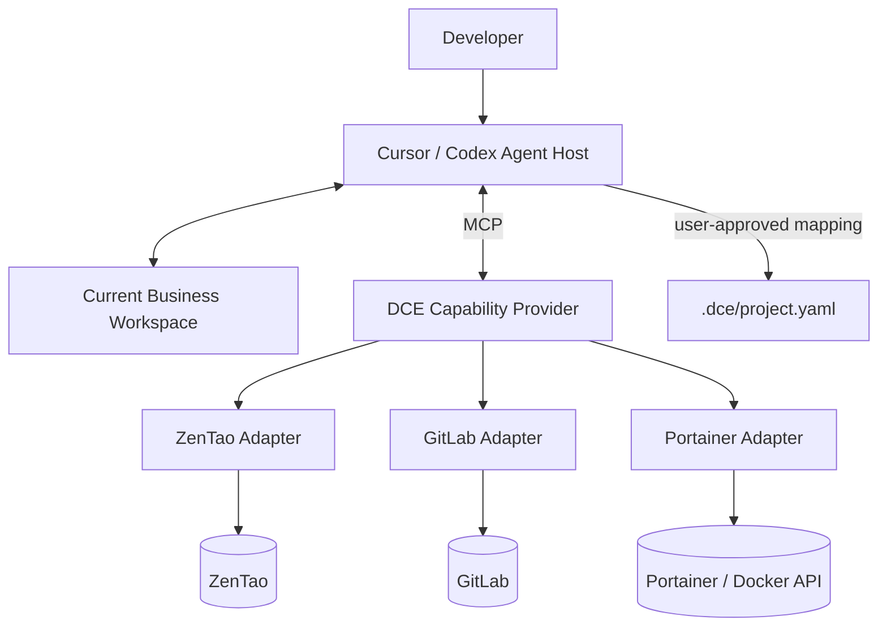

# 02 — 目标架构

## DCE = Data Plane
连接器、凭证、安全、分页、重试、错误规范化、结构化查询、附件/图片/日志交付、确定性技术事实提取、MCP Server、审计。

## Agent = Reasoning / Orchestration Plane
读取本地项目、规划查询、跨平台推理、冲突分析、向用户提问、保存项目关系、后续维护。

## Project Context = Project Data Plane
- `.dce/project.yaml`：关系与证据。
- `.dce/local.yaml`：本地配置覆盖，必须 gitignore。
- `.dce/runs/`：可选运行报告。
- `.dce/evidence/`：可选脱敏轻量证据摘要，不放大日志/二进制文件。

## 初始化数据流
1. Agent 识别 workspace、Git roots、Git Remote、语言和模块。
2. Agent 检查 DCE 连接状态。
3. 根据本地 remote/配置缩小 GitLab 查询范围。
4. 根据业务描述/用户输入查询禅道候选。
5. 根据 CI、镜像、部署仓库线索查询 Portainer/Swarm。
6. 形成多对多关系候选和 evidence。
7. 分开展示事实、推断、未知、冲突。
8. 用户确认。
9. Agent 写入当前项目 `.dce/project.yaml` 并校验。

## 证据优先级
- E1 直接配置：Git Remote、CI build context、Dockerfile、Compose image、Stack GitConfig、Swarm labels/image。
- E2 结构：Maven/Gradle/Go/Node 模块、目录引用、服务调用。
- E3 语义：禅道模块/缺陷描述、README、注释、模型推断。
E3 不得单独自动确认业务关系。

## 重要约束
一个禅道项目可关联多个 GitLab 仓库；一个仓库可包含多个代码 Module；一个 Module 可产生多个 Image；一个 Image 可部署到多个 Service/环境；多个 Module 也可能共享 Image/Service。Stack 名称、服务名相似度和数量相等都不是充分证据。不得仅凭 `test` 字样认定环境类型。
