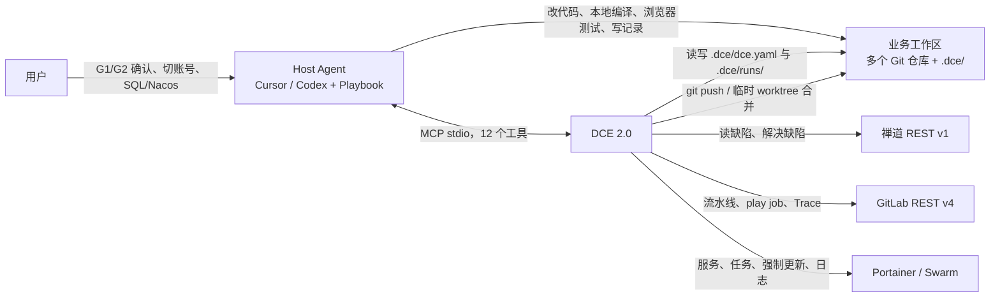

# 03 架构设计（DCE 2.0）

本文件中的地址、仓库名、服务名、ID 全部是合成示例。真实工作区的事实在本机私有文件 `.local/v2/field-facts.md`（已被 gitignore），不得写进仓库。

## 1. 总览



分层，从下到上：

1. **platforms**：三个平台客户端。只会发 HTTP，不知道业务配置。
2. **workspace**：项目配置 `dce.yaml` 的模型、扫描（scan）、自检（check）、CI 与 pom 解析。
3. **loop**：闭环步骤，包括计划、合并、构建、部署、缺陷、运行记录、守卫（guard）。
4. **接口**：`mcp_server.py` 和 `cli.py`，都是 loop/workspace 的薄包装，不含业务逻辑。

## 2. 代码目录（目标结构）

```text
src/dce/
  __init__.py            # __version__ = "2.0.0"
  errors.py              # DceError + ErrorCode（第 9 节）
  settings.py            # connections.toml + 凭证文件 → Settings（复用 common/config.py、security/local_credentials.py）
  redact.py              # 复用 security/redact.py
  output.py              # 统一返回结构（第 10 节）
  platforms/
    http.py              # PlatformClient：GET + 写接口白名单（复用 connectors/http.py 并扩展）
    zentao_auth.py       # 原样复用
    zentao.py            # bugs_page / bug / bug_actions / image_content / resolve
    gitlab.py            # project_by_path / branches / raw_file / pipelines / bridges / jobs / play / retry / create_pipeline / trace_tail
    portainer.py         # endpoints / stacks / registries / swarm_id / services / service / tasks / force_update / service_logs
    docker_logs.py       # 原样复用
  workspace/
    config.py            # DceConfig（pydantic）、load/save、定位工作区
    ci_parser.py         # .gitlab-ci*.yml → 模块/job/镜像
    pom.py               # Maven 模块、artifact、依赖
    scan.py              # project_setup scan
    doctor.py            # project_setup check
  loop/
    runs.py              # Run 模型 + 原子读写 + 文件锁 + 审计事件
    guard.py             # 所有写操作前的范围与分支检查
    gitops.py            # git 子进程封装、临时 worktree 合并
    plan.py              # deploy_plan
    build.py             # ci_build / ci_status
    deploy.py            # service_deploy / service_status
    bugs.py              # bug_list / bug_get / bug_resolve
  mcp_server.py          # 12 个工具
  cli.py                 # 与工具一一对应的子命令 + `dce mcp`
skills/dce-bugfix-loop/
  SKILL.md               # Playbook（内容见 docs/v2/07）
  record-template.md
```

每个文件只负责一件事。`mcp_server.py` 控制在 400 行以内，`loop/*.py` 单文件控制在 400 行以内。

## 3. 配置与凭证

### 3.1 连接配置（不含秘密），兼容 1.x

`~/.config/dce/connections.toml`：

```toml
allow_http = true            # 内网 HTTP 平台需显式开启
timeout = 15
max_retries = 1

[zentao]
base_url = "http://zentao.example.invalid/zentao"
[gitlab]
base_url = "http://gitlab.example.invalid"
[portainer]
base_url = "http://portainer.example.invalid:9000"
```

`base_url` 也可以在凭证文件里用 `ZEN_URL` / `GITLAB_URL` / `PORTAINER_URL` 提供（兼容现有文件）。

### 3.2 凭证文件

`~/.config/dce/credentials.env`，权限必须是 0600，只做字面解析，不执行 shell。沿用 1.x 的别名：

| 键（任一别名） | 用途 | 权限要求 |
|---|---|---|
| `ZEN_USER` / `DCE_ZENTAO_ACCOUNT` | 禅道账号 | 能查看产品缺陷、能“解决”指派给自己的缺陷 |
| `ZEN_PASSWORD` / `DCE_ZENTAO_PASSWORD` | 禅道密码 | — |
| `GITLAB_TOKEN` / `DCE_GITLAB_TOKEN` | GitLab 个人访问令牌 | **api** scope（play job、新建流水线需要；1.x 的 read_api 不够） |
| `PORTAINER_API_KEY` / `DCE_PORTAINER_TOKEN` | Portainer API Key | 该用户对测试 endpoint 有服务更新权限 |

错误必须具体：文件权限不对、缺哪个键、哪个 URL 无效，各自不同的报错。1.x 的笼统报错“Invalid DCE configuration.”不再允许。

### 3.3 项目配置 `.dce/dce.yaml`（业务工作区根目录）

由 `project_setup scan` 生成，用户在编辑器里修改。文件可以提交到工作区仓库，不含任何凭证。

```yaml
version: 2
name: demo-platform

zentao:
  product: 100                 # 只处理该产品的缺陷
  account: dev01               # “指派给我”的账号；缺省取凭证里的账号
  resolve:
    resolution: fixed
    resolved_build: trunk
    assign_to: opener          # opener = 缺陷的 openedBy；也可写具体账号

portainer:
  endpoint: 1
  registry_id: 2               # 私有镜像仓库在 Portainer 中的 ID；scan 自动发现

environment:                   # 本期只有测试环境
  name: test
  stack: demo_test             # Swarm stack namespace（服务标签 com.docker.stack.namespace）
  swarm_id: abc123def456       # 部署前比对当前集群 ID
  urls:
    main: http://test.example.invalid/main/
  test_notes: .dce/test-notes.md   # 浏览器测试知识（入口、iframe、账号要求、参照系统）

records:
  repo: demo-pm                # 修复记录所在仓库（repos 中的 name）
  branch: main
  file: projects/demo/V1.2.0/缺陷修复记录.md   # 相对 repo 根目录
  assets_dir: assets           # 相对 file 所在目录

gates:
  fix_plan: when_unclear       # always | when_unclear
  merge: always                # 本期只允许 always

protected_branches: [master, main, "release*", "prod*", "uat*"]   # 合并目标永远不能匹配；只能追加

build_order: []                # 可选，按仓库名覆盖默认拓扑顺序

repos:
  - name: demo-common
    path: demo-common          # 相对工作区根目录
    gitlab: { project: demo/demo-common, id: 11 }
    feature_branch: feature/1.2.0
    test_branch: develop
    ci: { mode: direct, file: .gitlab-ci-dev.yml }
    modules:
      - path: demo-common-core
        kind: library          # library | service | web
        artifact: com.demo:demo-common-core
        compile_job: deploy_common_core
  - name: demo-cloud
    path: demo-cloud
    gitlab: { project: demo/demo-cloud, id: 12 }
    feature_branch: feature/1.2.0
    test_branch: develop_v2    # TODO(确认): 远端同时存在 develop 与 develop_v2，CI 规则只引用 develop
    ci: { mode: child, trigger_job: trigger_dev, file: .gitlab-ci-dev.yml }
    modules:
      - path: demo-modules/demo-order
        kind: service
        artifact: com.demo:demo-modules-order
        compile_job: compile_demo_order
        build_job: build_demo_order
        image: demo/demo-modules-order
        services: [demo_test_demo-modules-order]
        uses: [com.demo:demo-common-core]
  - name: demo-web
    path: demo-web
    gitlab: { project: demo/demo-web, id: 13 }
    feature_branch: feature/1.2.0
    test_branch: develop
    ci: { mode: direct, file: .gitlab-ci.yml }
    modules:
      - path: .
        kind: web
        compile_job: compile_demo_web
        build_job: build_demo_web
        image: demo/demo-web
        services: [demo_test_demo-web]
  - name: demo-pm               # 没有 modules 的仓库不可部署（例如文档仓库）
    path: demo-pm
    gitlab: { project: demo/demo-pm, id: 14 }
```

校验规则（`workspace/config.py`）：

- `version == 2`；`repos[].name` 唯一；`path` 必须在工作区内且不能是符号链接逃逸。
- `test_branch` 不得匹配 `protected_branches`；`protected_branches` 必须包含默认的五项。
- `library` 模块必须有 `artifact` 和 `compile_job`，不能有 `build_job`/`services`。
- `service`/`web` 模块必须有 `compile_job` 或 `build_job`（至少一个），以及 `image` 和非空的 `services`。
- `services` 里每个名字必须以 `<environment.stack>_` 开头。
- 每个模块的 `path` 在同一仓库内唯一；`.` 只能单独出现。
- 校验失败时给出 YAML 路径，例如 `repos[1].modules[0].services[0]: 必须以 demo_test_ 开头`。

### 3.4 工作区定位（取代 1.x 的 Host Roots）

按以下优先级确定工作区：

1. 工具参数 `workspace`（绝对路径）；
2. 启动参数 `--workspace`；
3. 进程当前目录中存在 `.dce/dce.yaml` 时用当前目录；
4. 都没有则返回 `WORKSPACE_REQUIRED`，提示“请在工具参数中传入业务工作区绝对路径，或在项目级 .cursor/mcp.json 中加 --workspace ${workspaceFolder}”。

如果同时存在第 1 项和第 2 项，两者必须相同，否则返回 `WORKSPACE_MISMATCH`，防止串项目。不调用 MCP `roots/list`。

推荐的 Cursor 配置：放在**业务工作区**的 `.cursor/mcp.json`，同时删除全局 `~/.cursor/mcp.json` 里的 `dce` 条目，避免出现两个 DCE 进程。

```json
{
  "mcpServers": {
    "dce": {
      "command": "/abs/path/devops-context-engine/.venv/bin/dce",
      "args": ["mcp",
               "--connections", "/Users/me/.config/dce/connections.toml",
               "--credentials", "/Users/me/.config/dce/credentials.env",
               "--workspace", "${workspaceFolder}"]
    }
  }
}
```

Codex：在 `~/.codex/config.toml` 的 `[mcp_servers.dce]` 中写同样的 command/args，`--workspace` 写业务工作区的绝对路径。

### 3.5 工作区里的文件

| 路径 | 谁写 | 是否提交 |
|---|---|---|
| `.dce/dce.yaml` | scan 生成、用户编辑 | 可以提交 |
| `.dce/dce.proposed.yaml` | 已有配置时的 scan 输出 | 不提交 |
| `.dce/test-notes.md` | scan 生成空模板，Agent/用户补充 | 可以提交 |
| `.dce/runs/<run_id>.json` | DCE | 不提交 |
| `.dce/tmp/` | DCE（临时 worktree） | 不提交 |

scan 在工作区根目录是 Git 仓库时，向其 `.gitignore` 追加 `.dce/runs/`、`.dce/tmp/`、`.dce/dce.proposed.yaml`（已存在则跳过），并在结果里说明。

## 4. 运行记录（Run）

一次 run 对应一批一起合并部署的缺陷。文件：`.dce/runs/<run_id>.json`，`run_id` 形如 `20261113-1530-4336-4327`。

```json
{
  "run_id": "20261113-1530-4336-4327",
  "created_at": "2026-11-13T15:30:00+08:00",
  "updated_at": "...",
  "stage": "planned",
  "bugs": [{"id": 4336, "title": "...", "opened_by": "tester01", "opened_at": "...", "status": "active"}],
  "feature_branches": {"demo-cloud": "feature/1.2.0"},
  "plan": {
    "items": [
      {"id": "demo-cloud:demo-modules/demo-order", "repo": "demo-cloud", "module": "demo-modules/demo-order",
       "kind": "service", "reason": "changed", "bugs": [4336], "required": true,
       "compile_job": "compile_demo_order", "build_job": "build_demo_order",
       "image": "demo/demo-modules-order", "services": ["demo_test_demo-modules-order"]}
    ],
    "order": ["demo-common:demo-common-core", "demo-cloud:demo-modules/demo-order"],
    "commits": {"demo-cloud": [{"sha": "...", "subject": "fix(order): ... bug#4336", "bugs": [4336]}]},
    "warnings": []
  },
  "merges": {"demo-cloud": {"feature_sha": "...", "merge_sha": "...", "merged_at": "...", "test_branch": "develop_v2"}},
  "builds": {"demo-cloud:demo-modules/demo-order": {
     "pipeline_id": 900, "child_pipeline_id": 901,
     "compile": {"id": 5001, "status": "success", "web_url": "..."},
     "build": {"id": 5002, "status": "success", "finished_at": "...", "digest": "sha256:..."}}},
  "deploys": {"demo_test_demo-modules-order": {
     "service_id": "...", "before": {"digest": "sha256:...", "version": 120},
     "requested_at": "...", "verdict": "converged", "running_digest": "sha256:..."}},
  "verifications": {"4336": {"result": "passed", "notes": "...", "evidence": ["demo-pm/.../assets/4336-xxx.png"], "at": "..."}},
  "record": {"file": "projects/demo/V1.2.0/缺陷修复记录.md", "commit": "abc123", "at": "..."},
  "zentao": {"4336": {"action": "resolved", "at": "..."}},
  "events": [{"at": "...", "tool": "merge_to_test", "action": "merge", "target": "demo-cloud→develop_v2", "result": "ok", "detail": "merge_sha=..."}]
}
```

阶段（`stage`）只用来提示下一步，**不作为硬性状态机**：

`planned → merged → building → built → deploying → deployed → verifying → verified → recorded → resolved`；任意阶段可回到 `fixing`（测试不通过、合并冲突、构建代码失败）。

写入规则：先写临时文件再 `os.replace`；写前用 `fcntl.flock` 锁定 `<run_id>.lock`；`events` 只追加。

## 5. 扫描（project_setup scan）

输入：工作区路径。输出：`dce.yaml`（或 `dce.proposed.yaml`）+ 汇总表 + TODO 数。目标耗时不超过 2 分钟。

1. **找仓库**：工作区根目录的直接子目录中含 `.git`（目录或文件）的；跳过隐藏目录和 `.worktrees`。读 `origin` 地址，去掉用户名密码，主机必须与 GitLab `base_url` 一致，得到 `namespace/project`。
2. **GitLab 项目**：`GET /api/v4/projects/:url-encoded-path` 拿 `id`、`default_branch`；`GET /projects/:id/repository/branches?search=develop` 拿候选测试分支。
3. **CI 解析**（`ci_parser.py`，第 5.1 节）：用 `GET /projects/:id/repository/files/:path/raw?ref=<候选分支>` 读根 `.gitlab-ci.yml`，确定测试分支、模式（direct/child）、子 CI 文件，再解析出模块列表。
4. **库与依赖**（`pom.py`，第 5.2 节）：用本地 pom 文件计算各模块的 `artifact` 和 `uses`。
5. **Portainer**：
   - endpoint：配置里有就用，否则 `GET /api/endpoints`，只有一个 Swarm endpoint 时自动选，否则写 TODO；
   - `GET /api/endpoints/:id/docker/info` 取 `Swarm.Cluster.ID`；
   - `GET /api/endpoints/:id/docker/services` 取全部服务，从 `Spec.TaskTemplate.ContainerSpec.Image` 去掉 registry 主机、tag 和 digest，得到镜像仓库路径；
   - 把每个模块的 `image` 与服务镜像路径**精确**比较，按 `com.docker.stack.namespace` 分组计数，命中最多的 namespace 作为 `environment.stack`。并列时写 TODO 并列出候选；
   - `GET /api/stacks` 找到该 namespace 的 Stack，比对 `SwarmId` 与当前集群 ID，不一致时警告“这个 Stack 属于另一个集群”；
   - `GET /api/registries` 找到 URL 主机与镜像 registry 主机相同的那个，填 `registry_id`。
6. **记录文件**：在没有模块的仓库中查找文件名为 `缺陷修复记录.md` 的文件，取最近修改的一个填入 `records`，并加 `# TODO(确认)`。
7. **写文件**：
   - 没有 `dce.yaml` 时直接写；已有时写 `dce.proposed.yaml`，并返回差异：新增/删除的仓库、模块、服务，以及变化的字段；
   - 用 `ruamel.yaml` 保留注释。每个推断值后写简短来源注释，例如 `# 来自 .gitlab-ci-dev.yml 规则`；不确定处写 `# TODO(确认): 原因`。
8. 创建 `.dce/test-notes.md` 模板（不存在时），并更新 `.gitignore`（第 3.5 节）。

### 5.1 CI 解析规则（`ci_parser.py`）

只做静态解析，绝不执行脚本。输入 YAML 文本，输出：

```python
@dataclass
class CiJob:
    name: str
    stage: str | None
    when_on_branch: dict[str, str]   # 分支名 → "manual" | "on_success" | "never"
    needs: list[str]
    changes: list[str]               # rules.changes 展开后的模式
    variables: dict[str, str]        # 合并 extends 之后的变量
    script: list[str]
    trigger_include: str | None      # trigger.include 的本地文件
    image_pushes: list[str]          # 展开后的 docker push / build -t 目标
    maven_projects: list[str]        # -pl 参数
    maven_deploy: bool               # 脚本含 mvn ... deploy
```

规则：

1. **安全加载**：使用 `yaml.safe_load`；单文件不超过 1MB；允许锚点和别名（CI 常用），但加载前的 token 数超过 50000 时拒绝。顶层必须是映射。
2. **extends**：支持字符串或列表，递归解析，最多 5 层；按 GitLab 语义深度合并字典，列表和标量由子项覆盖。以 `.` 开头的隐藏 job 只作模板，不输出。
3. **变量**：优先级为 job 变量 > 模板变量 > 全局 `variables`。展开 `$VAR` 和 `${VAR}`；脚本行中 `export A=B` 按顺序生效。未定义的变量保留原样。
4. **分支规则**：`rules[].if` 中匹配 `$CI_COMMIT_REF_NAME == "x"` 或 `$CI_COMMIT_BRANCH == "x"`（单引号、双引号都支持；`=~ /^x$/` 当作等于 x），得到 `when`，没写 `when` 时为 `on_success`；`- when: never` 兜底项忽略；不认识的表达式记一条 warning。
5. **child 模式**：根文件中带 `trigger.include` 的 job 按分支规则区分，测试分支命中的那个 job 的 include 文件就是要再次解析的子 CI 文件，`ci.mode = child`，`trigger_job` 为该 job 名。
6. **镜像**：取 `docker push X` 的目标，没有 push 时取 `docker build -t X`。展开变量后，若开头是未定义变量加 `/`（如 `$REGISTRY_DEV/`），去掉这一段当作 registry；再去掉 `:tag`，得到 `image`（例如 `demo/demo-modules-order`）。
7. **模块路径**：优先取 `rules.changes` 中展开后的模式去掉 `/**/*` 等通配后缀；其次取 `-pl` 中的路径或 artifactId 再对应到目录；前端单镜像仓库用 `.`。
8. **compile/build 配对**：有镜像推送的 job 是 build job；它 `needs` 指向的 job 是 compile job。没有 build、但 `maven_deploy` 为真的 job 视为 library 的 compile job。
9. **测试分支选择**：收集所有规则中出现的、以 `develop` 开头的分支名，与 GitLab 远端分支取交集。只有一个时直接用；有多个，或远端还有其他 `develop*` 分支时，选 CI 引用的那个并写 `TODO(确认)` 列出全部候选。

测试夹具用合成文件覆盖三种形态（模板 + 子流水线的 Maven 多模块、直接 job 的前端、只发布 jar 的库），外加一个带未知表达式的反例。

### 5.2 pom 解析（`pom.py`）

- 只用 `xml.etree.ElementTree`，拒绝含 `<!DOCTYPE`/`<!ENTITY` 的文件。
- 每个模块目录的 `pom.xml`：`groupId`（缺省取 parent）+ `artifactId` 组成 `artifact`；`dependencies/dependency` 收集依赖的 artifact。
- 仓库内闭包：模块 A 依赖同仓库模块 B 时，A 的 `uses` 并入 B 的 `uses`。
- 跨仓库：`uses` 只保留在配置中被声明为 `library` 的 artifact，以及同仓库内的 artifact。
- 非 Maven 仓库跳过，不报错。

## 6. 闭环算法

### 6.1 部署计划（`plan.py`）

输入：`bug_ids`、可选 `repos`、可选 `feature_branches`、可选 `run_id`（刷新已有计划）、可选 `add_items`/`drop_items`。

对每个候选仓库（默认取配置中全部有模块的仓库；传了 `repos` 就只用这些）：

1. `git fetch origin <feature> <test> master`（只取这三个分支，超时 60 秒；master 用于第 7 步的检查，远端没有 master 时跳过第 7 步）。
2. 特性分支：`feature_branches` 参数 > 配置 `feature_branch`。若该分支被某个 worktree 检出（`git worktree list --porcelain`），在那个 worktree 中检查：
   - `git status --porcelain` 非空：警告 `DIRTY`；
   - 本地领先 `origin/<feature>`：警告 `UNPUSHED`（合并时会先推送）；
   - 若当前检出的是测试分支，且本地测试分支领先 `origin/<test>`：警告 `COMMITTED_ON_TEST_BRANCH`（合并时拒绝）。
3. 待合并提交：`git log --format=%H%x1f%s%x1f%an%x1f%aI origin/<test>..<feature>`。为空且没有 `add_items` 时跳过该仓库。从提交信息中按 `bug#(\d+)` 提取缺陷号。
4. 改动文件：`git diff --name-only $(git merge-base origin/<test> <feature>) <feature>`。
5. 映射：按模块 `path` 做最长前缀匹配（`.` 匹配全部）。匹配不上的文件放入 `unmapped`，并警告 `UNMAPPED_CHANGES`（例如根 pom、共享目录），由 Agent 判断后用 `add_items` 补充。
6. 下游：library 模块有改动时，凡 `uses` 含其 artifact 的模块，生成 `reason: "depends_on:<artifact>"`、`required: false` 的条目。
7. 简单污染检查：`git log --merges --format=%H%x1f%P origin/master..<feature>`，若某个合并提交的第二父提交是 `origin/<test>` 的祖先、却不是 `origin/master` 的祖先，警告 `TEST_BRANCH_MERGED_INTO_FEATURE`（测试分支代码混进了特性分支，后续上预发会带出未发布代码）。
8. 排序：先按 `build_order`（若配置了）；再在条目之间按 `uses` 做拓扑排序（被依赖的在前）；同层按 library → service → web，最后按名字。
9. 写入 run（新建或更新），返回“打包部署顺序表”：

| 顺序 | 仓库 | 合并 | 编译 job | 构建 job | 镜像 | 服务 | 原因 | 缺陷 |
|---|---|---|---|---|---|---|---|---|
| 1 | demo-common | feature/1.2.0 → develop | deploy_common_core | — | — | — | 改动 | 4336 |
| 2 | demo-cloud | feature/1.2.0 → develop_v2 | compile_demo_order | build_demo_order | demo/demo-modules-order | demo_test_demo-modules-order | 依赖 demo-common-core（建议） | 4336 |

### 6.2 合并到测试分支（`gitops.py`）

前置检查（任一失败即拒绝该仓库，其他仓库照常处理并分别报告）：

- run 中有计划，且该仓库有条目；
- 测试分支等于配置值，且不匹配 `protected_branches`；
- 特性分支所在 worktree 干净；当前检出不是测试分支，或本地测试分支没有领先 origin；
- `gates.merge == always` 时，参数 `approved_by_user` 必须为 `true`。它是流程标记，真正的控制是宿主对 `merge_to_test` 的人工确认（见 07）。

步骤：

1. `git push origin <feature>:refs/heads/<feature>`（普通推送；被拒绝就报 `GIT_PUSH_REJECTED`，提示先 pull/rebase 特性分支）。
2. `git fetch origin <test>`。
3. `git worktree add --detach .dce/tmp/merge-<repo>-<rand> origin/<test>`（worktree 放在工作区的 `.dce/tmp` 下，路径用仓库绝对路径）。
4. 在该 worktree 中执行 `git merge --no-ff --no-edit -m "Merge branch '<feature>' into <test> (bug#4336 bug#4327)" origin/<feature>`。
5. 有冲突时：`git merge --abort`，收集 `git diff --name-only --diff-filter=U`，删除 worktree，返回 `GIT_CONFLICT` 和冲突文件列表。
6. `git push origin HEAD:refs/heads/<test>`；因竞争被拒时 fetch 后重新合并一次，仍失败就报错。
7. 记录 `merge_sha`、`merged_at`（以推送成功时间为准，作为修复记录里的“修复时间”）。
8. 删除临时 worktree（`git worktree remove --force` 只用于这个临时目录）。

`origin/<test>` 已包含特性分支时，记录 `merge_sha = origin/<test>` 并标注 `already_merged`。

git 调用一律用 `subprocess.run([...], shell=False, timeout=…)`，环境变量加 `GIT_TERMINAL_PROMPT=0`，不在参数里放凭证（使用用户本机已有的 git 凭证）。

### 6.3 编译构建（`build.py`）

`ci_build(run_id, items?, retry_failed=false)`，对每个已合并仓库：

1. 找流水线：`GET /projects/:id/pipelines?ref=<test>&sha=<merge_sha>`。没有就每 5 秒重试，最多 45 秒。
2. `mode: child` 时：`GET /projects/:id/pipelines/:pid/bridges`，找 `name == trigger_job` 的 bridge，取 `downstream_pipeline.id`。
3. 列 job：`GET /projects/:id/pipelines/:pid/jobs?per_page=100`（翻页直到取完）。
4. 对每个计划条目，先处理 compile job，再处理 build job（library 条目没有 build job）：
   - compile 为 `manual`：调用 `POST /projects/:id/jobs/:job_id/play`；
   - compile 为 `failed`/`canceled`：`retry_failed=true` 时调用 `POST /projects/:id/jobs/:job_id/retry`，否则不动并报告；
   - compile 为 `success` 时看 build：build 为 `manual` 就 play；为 `failed`/`canceled` 且 `retry_failed=true` 就 retry；为 `success` 但结束时间早于 compile 的开始时间（旧构建），也 retry；
   - 其他状态（created/pending/running）不动。
   - `ci_build` 可以重复调用，每次只处理上面这些需要动作的 job，所以 compile 成功后再调一次即可触发手动 build。
5. 推送流水线里没有该 job（`changes` 规则未命中，例如只改了上游库）时：在测试分支上新建流水线 `POST /projects/:id/pipeline {"ref": "<test>"}`（每仓库每个 run 最多一次，记录 pipeline id），再从第 2 步找；仍然没有就返回 `CI_JOB_MISSING`，附流水线链接。
6. 不 play 计划外的 job。同一流水线中的其他手动 job 保持原状。

`ci_status(run_id, wait_seconds=0)`：

- 每 5 秒刷新一次相关 job，直到状态变化或超时（最长 45 秒）。
- `ci_status` 只读，不触发任何 job。compile 成功后，build job 应进入 created/pending/running；若 build 停在 `manual`，或 build 的结束时间早于本次 compile 的开始时间（判定为“旧构建”，不算成功），`next` 提示再次调用 `ci_build`。
- build 成功后取 Trace 尾部：`GET /projects/:id/jobs/:job_id/trace`，最多读最后 200 行。用正则 `(?m)digest:\s*(sha256:[0-9a-f]{64})` 取最后一个匹配作为镜像 digest；取不到时 `digest = null`，并警告 `DIGEST_UNKNOWN`。
- 失败分类（Trace 尾部匹配，大小写不敏感）：
  - 基础设施：`Cannot connect to the Docker daemon`、`TLS handshake timeout`、`i/o timeout`、`context deadline exceeded`、`no basic auth credentials`、`pull access denied`、`toomanyrequests`、`runner system failure`、`ERROR: Job failed (system failure)`、`no space left on device`；
  - 代码：`BUILD FAILURE`、`COMPILATION ERROR`、`npm ERR!`、`ERR_PNPM`、`error TS\d+`、`Module not found`、`SyntaxError`；
  - 都不匹配：`unknown`。
  - 失败时返回分类和 Trace 尾部最后 80 行（经过脱敏）。基础设施失败时，Playbook 让 Agent 问用户是否重试。
- run 阶段：全部 build 成功（library 是 compile 成功）为 `built`，有失败为 `fixing`（代码失败）或保持 `building`（基础设施失败，等用户决定）。

### 6.4 部署与核验（`deploy.py`）

`service_deploy(run_id, items?)`：

1. 前置条件：条目 `kind` 为 service/web，其 build 状态为 success 且不是旧构建。不满足的服务标记为 `skipped`（原因“构建未完成”或“旧构建”），不发任何写请求，其他服务照常处理；全部被跳过时整体返回 `PRECONDITION_FAILED`。这一步直接防住“镜像还没构建完就去更新”。
2. 守卫：服务名在配置中；`GET /api/endpoints/:ep/docker/info` 的集群 ID 等于 `environment.swarm_id`；服务的 `com.docker.stack.namespace` 标签等于 `environment.stack`；服务镜像仓库路径等于条目的 `image`。
3. 记录部署前的镜像 digest、`Version.Index`、`UpdatedAt`。
4. 调用 `PUT /api/endpoints/:ep/forceupdateservice`，body 为 `{"ServiceID": "<id>", "PullImage": true}`，请求头 `X-Registry-Auth: base64({"registryId": <registry_id>})`（配置了 `registry_id` 时）。
5. 返回 404/405 时（Portainer 版本较老），回退为 Docker 接口：读服务 Spec，把 `TaskTemplate.ForceUpdate` 加 1，去掉镜像里的 `@sha256:...`，调用 `POST /api/endpoints/:ep/docker/services/:id/update?version=<Index>`，请求头同上。
6. 多个服务按计划顺序依次提交，不等待前一个完成。

`service_status(run_id | service, wait_seconds=0, logs_tail=0)`：

- `GET /api/endpoints/:ep/docker/services/:id` 和 `GET /api/endpoints/:ep/docker/tasks?filters={"service":["<id>"]}`。
- 判定：
  - `converged`：期望运行的任务全部 `running`；任务镜像 digest 等于构建 digest（构建 digest 未知时，要求不同于部署前 digest，并标注 `digest_unverified`）；`UpdateStatus.State` 为 `completed` 或没有该字段。
  - `updating`：仍在滚动。
  - `failed`：存在 `failed`/`rejected` 任务，或 `UpdateStatus.State` 为 `paused`/`rollback_*`。附任务的 `Status.Err` 和最近日志。
- `logs_tail > 0`（最多 300）时，用 `GET /api/endpoints/:ep/docker/services/:id/logs?since=<部署时间>&tail=N&stdout=1&stderr=1&timestamps=1` 取日志，复用 `docker_logs.py` 解码并脱敏。只允许配置中的测试环境服务；不需要单独的日志授权文件。

### 6.5 缺陷（`bugs.py`）

- `bug_list`：`GET /api.php/v1/products/:product/bugs?page=N&limit=100`，最多翻 10 页，本地过滤 `status` 与 `assignedTo`。
- `bug_get`：`GET /api.php/v1/bugs/:id`。先检查 `product == zentao.product`，不符直接返回 `OUT_OF_SCOPE`，不解析正文、不下载图片。正文用现有 `parse_steps` 转纯文本，并提取图片地址；附件和图片走现有 `image_content`（同源、禁止重定向、MIME 和文件头校验、2MB 上限），作为 MCP `ImageContent` 返回，默认最多 6 张，超出的列出名字。历史：响应中有 `actions` 字段就整理为 `{date, actor, action, comment}`；没有就返回空列表并加 warning `HISTORY_UNAVAILABLE`（真实实例字段待首次使用确认）。
- `bug_resolve`：
  - 前置条件：缺陷属于该 run；`verifications[bug].result == passed`；`record.commit` 存在；缺陷当前 `status == active`（已经是 resolved 的记 `skipped`）。
  - 调用 `POST /api.php/v1/bugs/:id/resolve`，body 为：
    `{"resolution": "fixed", "resolvedBuild": "trunk", "assignedTo": "<openedBy>", "comment": "<备注>"}`。
  - 备注模板（纯文本，换行用 `<br>`）：

    ```text
    已修复，测试环境验证通过。
    修复提交：demo-cloud feature/1.2.0 abc1234（fix(order): ... bug#4336）
    合入测试分支：develop_v2 def5678，2026-11-13 15:42
    部署：demo_test_demo-modules-order sha256:1a2b3c4d…
    验证：<verifications[bug].notes>
    记录：projects/demo/V1.2.0/缺陷修复记录.md（commit 9f8e7d6）
    ```

  - 完成后重新 `GET` 该缺陷，确认 `status == resolved`，否则返回 `PLATFORM_ERROR`。

## 7. 安全模型

### 7.1 写接口白名单（写死在 `platforms/http.py`）

| 平台 | 方法 | 路径模式 |
|---|---|---|
| 禅道 | POST | `/api.php/v1/tokens` |
| 禅道 | POST | `/api.php/v1/bugs/{int}/resolve` |
| GitLab | POST | `/api/v4/projects/{int}/jobs/{int}/play` |
| GitLab | POST | `/api/v4/projects/{int}/jobs/{int}/retry` |
| GitLab | POST | `/api/v4/projects/{int}/pipeline` |
| Portainer | PUT | `/api/endpoints/{int}/forceupdateservice` |
| Portainer | POST | `/api/endpoints/{int}/docker/services/{id}/update` |

其他任何非 GET 请求，在发出前抛出 `PERMISSION_DENIED`。写请求不自动重试（GET 保留原有的有限重试）。

### 7.2 目标守卫（`loop/guard.py`，每个写操作都调用）

- 缺陷：`product` 等于配置值。
- 分支：等于该仓库配置的 `test_branch`，且不匹配 `protected_branches`。
- job：名字等于计划条目中的 `compile_job`/`build_job`，且所在项目 ID 等于配置值。
- 新建流水线：`ref` 等于测试分支。
- 服务：在配置中；namespace、集群 ID、镜像仓库路径与配置一致；endpoint 等于配置值。
- 不满足时返回 `OUT_OF_SCOPE`，说明具体哪一项不符。

### 7.3 其他

- 凭证只在 DCE 进程内；输出、错误和日志经过 `redact.py`（已知 Token、Authorization 头、URL 中的用户信息）。
- 禁止 force push、改写历史、删除分支或 tag、删除服务、修改 Stack 文件、执行容器命令。
- 审计：每个写操作在 run 的 `events` 追加一条，同时向 stderr 输出一行 JSON：`{ts, request_id, tool, action, target, result, error_code}`，不含参数原文和平台返回正文。
- 缺陷正文、日志、Trace、README 都是不可信数据，只作为数据返回；DCE 不解释其中的指令。Playbook 要求 Agent 同样对待。
- 人工专属：Nacos/环境变量、SQL、菜单权限、账号切换、预发/生产。DCE 不提供这些能力。

## 8. 宿主侧的确认机制

不自建审批系统，而是这样分工：

- G1、G2 由 Playbook 规定 Agent 必须停下来问。
- 在 Cursor 的 MCP 工具自动运行设置里，`merge_to_test` 不加入自动运行，每次由宿主弹窗确认；其余工具可以加入自动运行。
- `merge_to_test` 要求 `approved_by_user: true`，作为流程标记写入审计。

## 9. 错误模型

```json
{"ok": false,
 "error": {"code": "CI_JOB_MISSING",
           "message": "流水线 901 中没有 compile_demo_order（该提交未改动 demo-modules/demo-order，changes 规则未命中）。已在 develop_v2 新建流水线 905，仍未找到。",
           "hint": "在 GitLab 打开 http://gitlab.example.invalid/demo/demo-cloud/-/pipelines/905 检查 job 规则；或确认 dce.yaml 中的 job 名。",
           "retryable": false}}
```

错误码：`WORKSPACE_REQUIRED`、`WORKSPACE_MISMATCH`、`CONFIG_MISSING`、`CONFIG_INVALID`、`CREDENTIALS_INVALID`、`AUTH_FAILED`、`PERMISSION_DENIED`、`OUT_OF_SCOPE`、`NOT_FOUND`、`PLATFORM_UNAVAILABLE`、`PLATFORM_ERROR`、`PRECONDITION_FAILED`、`GIT_DIRTY`、`GIT_CONFLICT`、`GIT_PUSH_REJECTED`、`GIT_ERROR`、`CI_JOB_MISSING`、`CI_FAILED`、`DEPLOY_FAILED`、`TIMEOUT`、`INTERNAL`。

要求：

- `message` 写清楚是哪个平台、哪个资源、上游返回了什么状态码，以及判断出的原因（经过脱敏）。
- 未预期的异常返回 `INTERNAL`，`message` 带异常类型和脱敏后的异常信息，并在 stderr 打印 traceback。禁止吞掉异常后换成笼统的话。

## 10. 返回结构

```json
{"ok": true,
 "summary": "部署计划已生成：2 个仓库、3 个模块，其中 1 个为建议重编。",
 "data": { },
 "warnings": [{"code": "UNMAPPED_CHANGES", "message": "demo-cloud: pom.xml 不属于任何模块"}],
 "next": "确认后调用 merge_to_test(run_id=..., approved_by_user=true)"}
```

- MCP 返回时，同一份 JSON 既放在 text content（紧凑格式），也放在 structuredContent；图片作为单独的 ImageContent。
- 文本超过 24KB 时，按工具截断列表（如 job、提交、日志），并在 `warnings` 中加 `TRUNCATED`，说明被截掉多少。
- `summary` 中能用表格的地方直接给 Markdown 表格，Agent 可以原样展示给用户。
