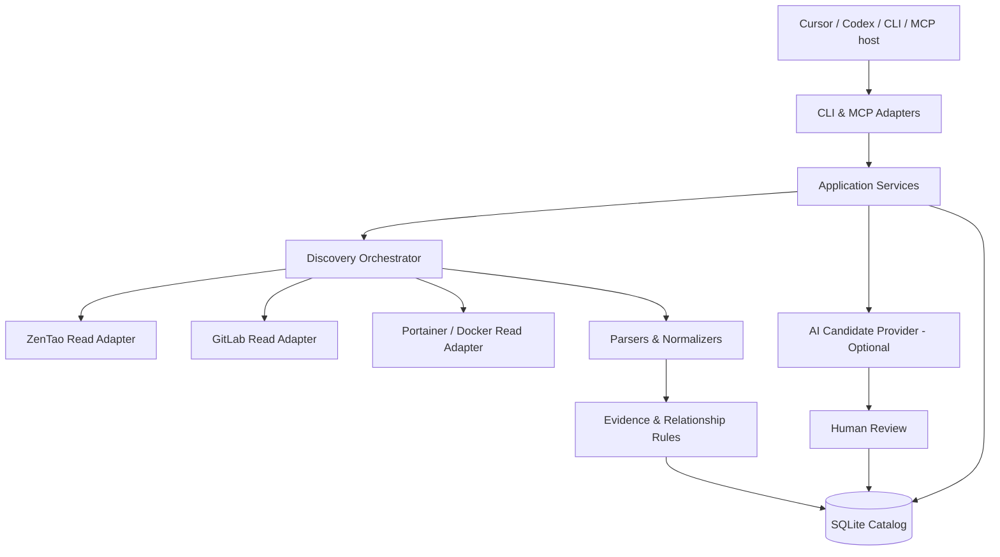

# DCE V1.0 — 技术设计（Design）

## 1. 架构原则

- **核心独立于入口**：`Application Services` 供 CLI、MCP、未来 FastAPI 复用，不在入口层写业务规则。
- **Reader → Normalizer → Snapshot → Evidence → Catalog**：采集器只读、解析器不执行脚本、规范化实体和关系后持久化。
- **观测事实 != 配置声明 != AI 推断 != 人工确认**：四类边与证据分开存储。
- **最小权限与确定性优先**：外部系统只读；AI 默认关闭；运行于内网、不要求对公网开放任何管理接口。



## 2. 技术栈与兼容性

- Python >=3.12；Typer/Rich、httpx、Pydantic v2、SQLAlchemy 2/Alembic、PyYAML 安全加载、BeautifulSoup4、pytest、ruff、mypy；uv 或 pip 均可，但项目统一锁版本。
- MCP Python SDK 提供本地 `stdio`，后续共享部署可加 Streamable HTTP。V1 先支持 stdio，且必须验证 `stdout` 仅发送 MCP 协议帧，日志写 `stderr`。
- AI Provider：协议接口 + mock provider，默认 no-op。AI 仅传递过滤后的元数据和经批准的文档摘录，完整源码与截图只有授权后方可出域。
- SQLite 单用户/本地 V1，所有接口以 Repository abstraction 实现，可在多人并发阶段迁移 PostgreSQL。

## 3. 分层包设计

```text
src/dce/
  cli/                  typer app / render / error handlers
  mcp/                  6 read tools + schema/limits
  app/                  doctor, discovery, mapping, catalog, bug-context usecases
  connectors/           zentao, gitlab, portainer, base/http/retry
  parsers/              pom, gradle, go, node, dockerfile, ci, compose, html
  discovery/            crawler, scope, checkpoints, snapshots
  graph/                rules, evidence, model, candidate_ranker
  ai/                   provider, schemas, prompt guard, redact
  catalog/              db models, migrations, repositories
  security/             policy, sanitization, URL allowlist, audit
  common/               config, errors, pagination, logging, types
```

## 4. 主要时序

### 初始化

1. `doctor` 探测 API 主机及权限，并对无权限能力生成 capability matrix。
2. `init --scope <...>` 创建 `ScanRun`、遍历三平台，分页与限速，原始敏感响应只保存在瞬时内存，不写日志。
3. Normalizer 生成实体，技术扫描生成 `Snapshot` 和带 source-path/ref/observed_at 的 `Evidence`。
4. Rules 提出 `observed` 和 `inferred` 边；相同证据 idempotent upsert；出现冲突只增添 `conflict`，不覆盖人工确认。
5. Optional AI 依据脱敏摘要输出 schema 化候选，必须附带至少一个可追溯资源引用；无依据则 `unresolved`。
6. 人工 review 记录审核事件；approved 的语义边状态为 `confirmed`；技术直接边维持 `observed_verified`，不与人工含义混淆。
7. 后续增量扫描计算 refs/etag/commit/cache hash 差异，复核变更依赖边，旧快照仍能查询。

### Bug Context

1. 调用 ZenTao 获取 bug/v1，解析项目与产品、保留 sanitized text、提取同域图片 URL。
2. 图片下载 `Token` 请求头，检查实际类型（Content-Type + 文件 magic）；存私有缓存目录，返回 `asset_id` 与本地路径（CLI）或授权资源（MCP），不返回无保护外网 URL。
3. Catalog 查询 confirmed 与 observed_verified 技术链；缺少业务映射时列候选；召回候选仓库目录/CI/Service。
4. 使用 allowlisted 字段生成 token 有限的 summary；附 `evidence_ids`、`uncertainties`、`snapshot_at`。

## 5. 深入边界

- Portainer Stack 中 `Status` 是记录状态，不是运行健康；`GitConfig` 中 Repository URL / Ref / ConfigHash 为声明信息，验证该 hash 是否对应 GitLab Commit 需单独 API 检查。
- `Namespace` 字段可能空；实时查询 Docker Swarm Service 标签 `com.docker.stack.namespace`，另查 Docker Info 的当前 Cluster ID；只有匹配后才可认定该 Stack 属当前 Swarm。
- `Compose current@master`、`Portainer saved StackFile`、`Running Docker services` 是三种独立 Snapshot。即使名称与服务个数相同也不能自动认为版本一致。
- 同一 Image 可以部署为多个 Service，使用 `repository + tag + digest` 分离表示；没有 digest 时将确定性降低，标记 `mutable_tag`。
- 无法通过静态解析确定的 YAML anchor/extends/CI include 应返回 `incomplete`，不能编造完整依赖图。
- Portainer Type 为 1 的 Swarm 环境与其他类型的 Docker Standalone/Kubernetes 后续通过适配层扩展，不将 Swarm 假设写进通用模型。

## 6. 失败与恢复

- 错误类型：`AUTH_FAILED`、`PERMISSION_DENIED`、`NOT_FOUND`、`API_INCOMPATIBLE`、`RATE_LIMITED`、`NETWORK_UNAVAILABLE`、`INVALID_PAYLOAD`、`UNSAFE_URL`、`SNAPSHOT_CONFLICT`、`REVIEW_REQUIRED`。
- 只读请求按 429/502/503 等做有上限退避，不能重试所有 4xx；爬取失败记录 checkpoint，不丢已有确认结果。
- AI 超时/结构化 JSON 无效：保留规则结果，标记 AI 阶段失败并能续跑；禁止无限模型重试。
- CLI 和 MCP 使用相同 `DceError` 语义结构；日志不打印 Authorization、Cookies、RepositoryAuthentication、GitConfig.Auth 数据。

## 7. 本地和内网部署

- 开发期：单机 CLI + SQLite + stdio MCP + mock 服务；`localhost` 默认绑定。
- 未来共享内网服务：FastAPI + Streamable HTTP，经身份认证、TLS/内网网关、按项目授权；不要将 Portainer/禅道直接暴露公网。
- 与 Cursor 的接入优先本地 stdio；Grok Bot 依据实际执行器能力调用 CLI 或受认证的内网 API，不假设云端具备公司内网可达性。
